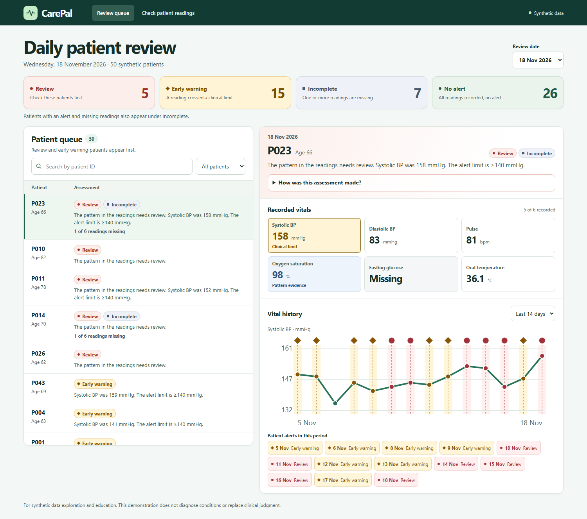

# CarePal Vitals Review

CarePal Vitals Review is a synthetic-data demo for TheCarePal AI/ML internship assignment AI-02. A care-team reviewer can open a date, switch between five scoring methods, and see which readings put a patient in the review queue. The prototype is for decision support and does not diagnose conditions or replace clinical judgment.

**[Open the live demo](https://avish006.github.io/TheCarePal-AI-02/)** · [Training notebook](train_kaggle.ipynb) · [Evaluation results](models/model_comparison.csv)



## Try the demo

- **Patient queue** ranks 50 synthetic patients by the selected scoring method. Choose a patient to see the reason for their score, missing readings, and recent trends.
- **Score a patient** accepts a synthetic ID and a list of dated measurements. Use **Load example** to try a four-day oxygen decline. The form scores the latest date against all five methods, using earlier rows as context. The browser processes the entered readings locally.
- **Evaluation** shows performance on separate validation and test patients, including detection before the planned peak of a gradual episode.

## Scoring methods

| Method | How it scores | What the dashboard explains |
| --- | --- | --- |
| Clinical rules | Published vital-sign thresholds | The reading and threshold that triggered review |
| Statistical baseline | Each patient's median, median absolute deviation, and recent sustained change | The reading and the patient's usual value |
| XGBoost | Learns labeled event-day patterns from current readings, changes, and rolling summaries | Feature contributions to that score |
| GRU autoencoder | Learns to reconstruct ordinary 14-day sequences. The largest standardized squared error among today's observed vitals sets the score. | The measured and reconstructed values for the largest errors |
| Ensemble | Flags a patient when either trained member crosses its own ensemble threshold | Which member alerted and the evidence behind its score |

The five methods have different score scales. A model's alert status is based on its own threshold. Explanations describe the evidence driving a score and support review of the measured readings.

### Clinical references

| Vital | Reference threshold used in the demo | Source |
| --- | --- | --- |
| Blood pressure | Systolic ≥140 or diastolic ≥90 mmHg | [American Heart Association](https://www.heart.org/en/health-topics/high-blood-pressure/understanding-blood-pressure-readings) |
| Resting pulse | <60 or >100 bpm | [MedlinePlus](https://medlineplus.gov/ency/article/002341.htm) |
| SpO₂ | ≤92% | [MedlinePlus](https://medlineplus.gov/lab-tests/pulse-oximetry/) |
| Fasting blood glucose | <70 mg/dL | [CDC](https://www.cdc.gov/diabetes/treatment/treatment-low-blood-sugar-hypoglycemia.html) |
| Oral temperature | ≥38 °C | [NHS](https://www.nhs.uk/symptoms/fever-in-adults/) |

## Data and evaluation

The [generator](generate_synthetic_vitals.py) produces **50 fictional patients across 90 days**. The [daily readings](data/vitals.csv) include systolic and diastolic BP, resting pulse, oxygen saturation, fasting glucose, and oral temperature. The [episode log](data/events.csv) records onset, planned peak, and end for **80 injected episodes across 331 patient-days**. A blank measurement is treated as missing. Event rates, severity, shapes, and missingness are simulation assumptions.

Training, validation, and testing use **30, 10, and 10 different patients**. Preprocessing uses readings through each scoring date, and the GRU learns from training windows free of injected episodes. Validation selects thresholds for episode recall within an experimental budget of **0.5 false alerts per patient-week**. Test metrics compare all methods on days 29–90 of held-out patients. An episode counts as caught if at least one alert occurs during the episode window.

| Test method | Episodes caught | Event-day recall | Alert precision | False-alert days |
| --- | ---: | ---: | ---: | ---: |
| Clinical rules | 17/17 | 77.2% | 27.4% | 162 |
| Statistical baseline | 16/17 | 64.6% | 62.2% | 31 |
| XGBoost | 17/17 | 81.0% | 69.6% | 28 |
| GRU autoencoder | 16/17 | 55.7% | 61.1% | 28 |
| Ensemble | 17/17 | 81.0% | 69.6% | 28 |

XGBoost and the ensemble gave identical held-out alerts on this seed. XGBoost and the ensemble also flagged 11 of 12 gradual episodes before their planned peak. These measurements describe the synthetic benchmark. Short-history scoring in the form is available for demonstration. The headline metrics use the mature-history test period.

## Run locally and reproduce training

The dashboard needs a browser and a static server. The optional Python server also provides the original baseline-backed JSON API at `/api/dashboard`.

```sh
git clone https://github.com/avish006/TheCarePal-AI-02.git
cd TheCarePal-AI-02
python app.py
```

Open [localhost:8765](http://127.0.0.1:8765/). The published files under `dist/` also run with `python -m http.server 8765 --directory dist`.

To retrain, import [the notebook](train_kaggle.ipynb) into Kaggle, attach all three CSVs in [data/](data/), and run every cell. The notebook writes both `.pkl` files, preprocessing settings, thresholds, and comparison tables to `/kaggle/working`. The [released model files](models/) are from the verified CPU run on the original data.

For local training and updating the static assets, use Python 3.10+ with NumPy, pandas, PyTorch, and XGBoost. The released dependency versions are recorded in [training_config.json](models/training_config.json).

```sh
python -m pip install numpy pandas torch xgboost
python train_kaggle.py --output-dir models
python export_site_data.py
python export_browser_models.py --artifacts models
python -m unittest -v
```

The browser uses the exported XGBoost trees and GRU weights. The static deployment runs on GitHub Pages. Local scoring can run offline once the assets are available. The app uses open-source libraries and has no metered inference API or application server cost.

GitHub Pages publishes the root of the `gh-pages` branch. After committing a site update, publish the updated `dist/` files with `git subtree push --prefix dist origin gh-pages`.

## Next steps and AI assistance

Evaluate more seeded cohorts and address changes in baseline, sparse histories, and unfamiliar episode shapes. Clinical use would require validation on representative patients and prospective review of alert burden. Codex assisted with software design, implementation, documentation, and verification.
